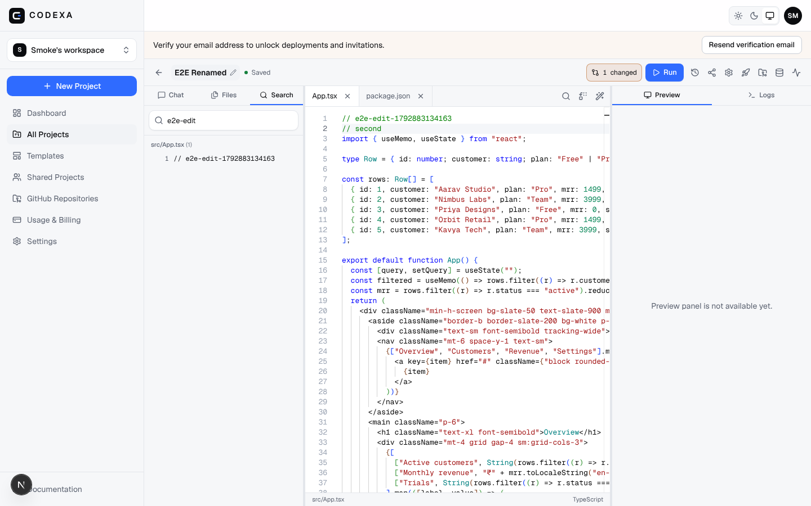

# Codexa

**Turn ideas into working software.** Codexa is an AI-native software development platform:
describe an application in natural language, generate a full-stack project, edit the code in a real
editor, run it in an isolated sandbox with a live preview, review and revert AI changes, connect
services, collaborate, and deploy.



## What is in this repository

| Area | Where | Status |
| --- | --- | --- |
| Public website (product, solutions, pricing, company, trust, support, forms, SEO) | `src/app/(marketing)` | ✅ 130 routes, tested |
| Documentation, guides, blog, help, changelog, roadmap, API reference, global search | `content/`, `src/lib/content`, `src/app/(marketing)/docs` … | ✅ |
| Templates gallery, integrations directory, community showcase | `src/templates`, `src/app/(marketing)/templates` … | ✅ 18 runnable starters |
| Accounts, sessions, email verification, password reset, GitHub sign-in (when configured) | `src/lib/auth`, `src/app/(auth)` | ✅ |
| Workspace: dashboard, projects, files, Monaco editor, snapshots/diff/restore, env vars, share links | `src/app/(app)`, `src/components/workspace` | ✅ |
| AI engine: Anthropic/OpenAI providers, tool-using agent, SSE streaming, review & revert, bounded repair | `src/lib/ai`, `src/components/ai` | ✅ (needs an API key; dev mock available) |
| Runtime: sandboxed execution (namespaces + cgroups), preview proxy, logs, allow-listed exec | `services/runner`, `src/lib/runtime` | ✅ local driver verified; Docker/E2B drivers unverified |
| Deployment: Codexa static hosting with history and rollback; Vercel adapter | `src/lib/deploy`, `services/runner/deployments.ts` | ✅ Codexa hosting verified; Vercel unverified |
| Integrations: GitHub import/commit/push, PostgreSQL/Supabase schema + SQL runner, provider connections | `src/lib/github`, `src/lib/integrations` | ✅ (GitHub OAuth needs an app) |
| Billing: Free/Pro/Team/Enterprise, INR + USD, Stripe + Razorpay, idempotent webhooks, server-side quotas | `src/config/plans.ts`, `src/lib/billing` | ✅ logic tested; live provider calls unverified |
| Teams: roles, invitations, settings; staff admin area; job worker; realtime presence | `src/app/(app)/settings`, `src/app/admin`, `services/worker`, `services/realtime` | ✅ |

See `docs/IMPLEMENTATION_PLAN.md`, `docs/AI_ENGINE.md`, `docs/RUNTIME.md`, `docs/INTEGRATIONS.md`,
`docs/BILLING.md` and `docs/API_CONTRACT.md` for details.

## Stack

Next.js 16 (App Router, Turbopack) · React 19 · TypeScript · Tailwind CSS v4 · Drizzle ORM + PostgreSQL ·
Monaco (self-hosted) · Vitest · Playwright. Three side services run with `tsx`: the sandbox **runner**, the
WebSocket **realtime** server and the Postgres-backed job **worker**.

## Run locally

Requirements: Node 22+, PostgreSQL 14+, Linux for the local sandbox driver (user namespaces + cgroups;
run the runner as root or with the needed capabilities).

```bash
cp .env.example .env.local            # fill SESSION_SECRET and ENCRYPTION_KEY (openssl rand -base64 32)
cp .env.local .env                    # side services read .env
npm install                           # also copies Monaco into public/monaco
createdb codexa && createdb codexa_test
npm run db:migrate                    # DATABASE_URL
DATABASE_URL=$TEST_DATABASE_URL npm run db:migrate
npm run db:seed                       # optional: admin@codexa.local / admin12345, demo@codexa.local / demo12345
npm run runner:prepare                # once: prebuilt dependency sets for templates (needs npm registry)
npm run dev:all                       # web :3000, runner :4000/:4100, realtime :4200
npm run worker:start                  # optional background jobs
```

Open http://localhost:3000. Without `RESEND_API_KEY`, verification and invite emails are stored in the
database and can be opened at http://localhost:3000/dev/mailbox (development only).

To exercise the AI pipeline without a provider key during development set `AI_MOCK=1`
(development/test only; the UI shows a "Mock AI" badge). Real generation needs `ANTHROPIC_API_KEY` or
`OPENAI_API_KEY`.

## Checks

```bash
npm run lint
npm run typecheck
npm run test             # 400+ unit + integration tests (uses TEST_DATABASE_URL)
npm run build
npm run test:e2e         # Playwright; core journey needs AI_MOCK=1 and the runner running
```

## Environment variables

All variables are documented in `.env.example`. Required: `APP_URL`, `DATABASE_URL`, `SESSION_SECRET`,
`ENCRYPTION_KEY`, `RUNNER_URL`, `RUNNER_TOKEN`. Optional integrations (each enables a capability and
otherwise renders an explicit "not configured" state): `ANTHROPIC_API_KEY`, `OPENAI_API_KEY`,
`RESEND_API_KEY`, `GITHUB_CLIENT_ID/SECRET`, `STRIPE_*`, `RAZORPAY_*`, `VERCEL_TOKEN`, `E2B_API_KEY`.

## Deployment

- **Web app**: `Dockerfile` builds a production image (`npm run build` / `npm run start`); run migrations
  with `npx drizzle-kit migrate` before starting. `docker-compose.yml` wires Postgres, web and runner.
- **Runner**: needs Linux user namespaces and cgroups (privileged container or a VM). Wildcard DNS for
  previews (`*.preview.<host>`) and sites (`*.sites.<host>`) must point at the runner's proxy port; set
  `PREVIEW_HOST`, `DEPLOY_HOST`, `PREVIEW_PROTOCOL`. See `docs/RUNTIME.md` for the hardening list.
- **Realtime** and **worker** are plain Node processes (`npm run realtime:start`, `npm run worker:start`).
- CI (`.github/workflows/ci.yml`) runs lint, typecheck, tests and build against a Postgres service.

## Security model (summary)

Server-side authorization on every route (`assertProjectAccess` / `assertWorkspaceRole`), httpOnly
session cookies with hashed tokens, scrypt passwords, AES-256-GCM for stored secrets, zod validation,
Postgres-backed rate limiting, audit logs, sandboxed execution outside the web process, destructive SQL
confirmation, idempotent payment webhooks. No third-party certifications are claimed.

## License

Proprietary. All rights reserved.
