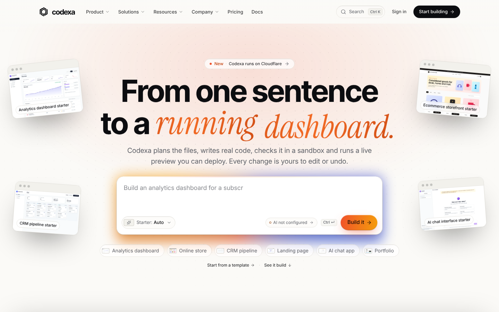
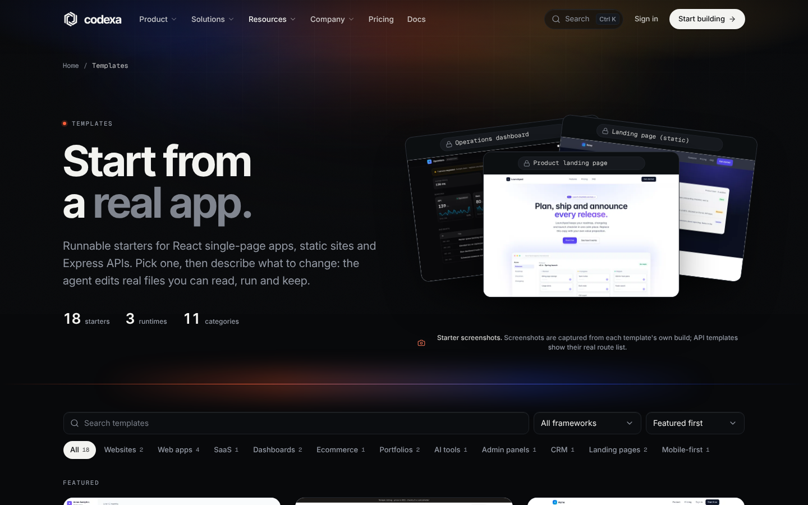
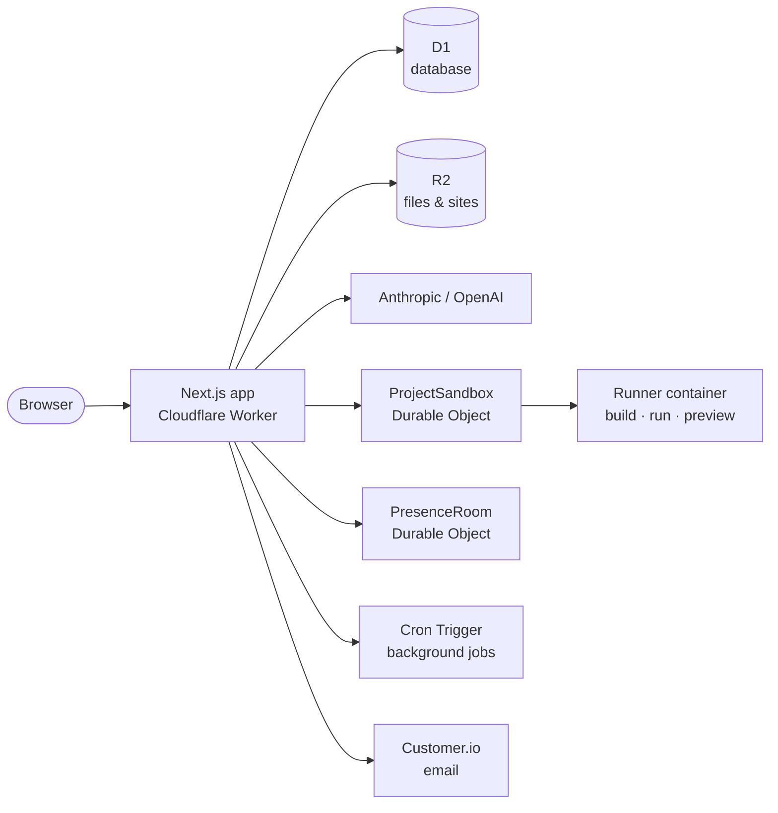

<div align="center">

<picture>
  <source media="(prefers-color-scheme: dark)" srcset="docs/brand/codexa-logo-on-dark.png">
  
</picture>

### From one sentence to a running app.

Codexa is an AI-native app builder. Describe what you want, and Codexa plans the files, writes real code,<br>
checks it in a sandbox, runs a live preview and deploys it. Every change is yours to read, edit or undo.

[**Website**](https://codexa.creditvault.tech) · [Docs](https://codexa.creditvault.tech/docs) · [Templates](https://codexa.creditvault.tech/templates) · [Changelog](https://codexa.creditvault.tech/changelog) · [Status](https://codexa.creditvault.tech/status)


<br>

<picture>
  <source media="(prefers-color-scheme: dark)" srcset="docs/screenshots/home-dark.png">
  
</picture>

</div>

## How it works

| | Step | What happens |
|---|---|---|
| 1 | **Describe** | Say what you want in plain words. Codexa picks the closest starter, or you choose one. |
| 2 | **Plan** | The agent reads the project and lists the files it will create or change. |
| 3 | **Generate** | It writes real, readable code in a full-stack project you own. |
| 4 | **Validate** | Type checks and builds run in an isolated sandbox; failures are repaired a bounded number of times. |
| 5 | **Preview** | A live preview runs in its own container, next to the code. |
| 6 | **Ship** | Deploy to Codexa hosting with history and one-click rollback, or push to GitHub. |

<p align="center">
  
  <br>
  <sub>The workspace, as shown in the scripted replay on the home page (illustration, not a recording).</sub>
</p>

## Features

<table>
<tr>
<td width="50%" valign="top">

**AI agent**
- Anthropic and OpenAI providers, bring your own key
- Tool-using agent with streamed steps (SSE)
- Review every change as a diff; revert with one click
- Bounded self-repair when a build or type check fails

**Editor & workspace**
- Monaco editor (self-hosted), file tree, quick open, terminal
- Snapshots, version history, diff and restore
- Environment variables, encrypted at rest
- Share links and realtime presence

</td>
<td width="50%" valign="top">

**Run & deploy**
- One sandboxed Cloudflare Container per project
- Live preview on its own address
- Codexa hosting on R2 with history and rollback
- GitHub import, commit and push

**Platform**
- 18 runnable starter templates
- 9 integrations: AI, payments, email, databases, hosting
- Teams with roles and invitations, admin area
- Plans in INR and USD with Stripe and Razorpay

</td>
</tr>
</table>

<p align="center">
  
</p>

## Architecture

Everything runs on Cloudflare. Generated code never runs inside the web app: only inside a per-project container.



| Layer | Technology |
|---|---|
| Web app | Next.js 16 (App Router, Turbopack), React 19, TypeScript (strict), Tailwind CSS v4 |
| Hosting | Cloudflare Workers via `@opennextjs/cloudflare` |
| Data | Cloudflare D1 (SQLite) with Drizzle ORM; R2 for files, avatars and hosted sites |
| Runtime | Cloudflare Containers, one per project, owned by the `ProjectSandbox` Durable Object |
| Realtime & jobs | `PresenceRoom` Durable Object; Cron Trigger draining a job queue |
| Email | Customer.io (or Resend) |
| Testing | Vitest (unit and integration), Playwright (end to end) |

## Getting started

**Requirements:** Node.js 22+. On Windows or macOS, use `npm run cf:preview` for live previews (needs Docker Desktop). On Linux, `npm run dev:all` runs everything natively.

```bash
git clone https://github.com/sangralrahul/codexa.git
cd codexa
cp .env.example .env.local      # set SESSION_SECRET and ENCRYPTION_KEY (openssl rand -base64 32)
cp .env.local .env              # side services read .env
npm install                     # also copies Monaco into public/monaco
npm run db:migrate              # creates the local D1 database
npm run db:seed                 # optional demo accounts
npm run runner:prepare          # once: prebuilt dependencies for the templates
npm run dev:all                 # web :3000 · runner :4000/:4100 · realtime :4200
```

Open http://localhost:3000.

<details>
<summary><b>Run the production build locally (Cloudflare runtime)</b></summary>

<br>

Copy `.dev.vars.example` to `.dev.vars`, then:

```bash
npm run cf:preview              # production build in local workerd, real containers via Docker
```

Open http://localhost:8787.

</details>

<details>
<summary><b>Try the AI pipeline without a provider key</b></summary>

<br>

Set `AI_MOCK=1` (development and test only; the UI shows a "Mock AI" badge). Real generation needs `ANTHROPIC_API_KEY` or `OPENAI_API_KEY`.

Without an email provider, verification and invite emails are stored and readable at http://localhost:3000/dev/mailbox (development only).

</details>

## Configuration

All variables are documented in `.env.example` (local) and `.dev.vars.example` / `wrangler.jsonc` (Cloudflare).

| Variable | Required | Enables |
|---|---|---|
| `SESSION_SECRET`, `ENCRYPTION_KEY`, `APP_URL` | Yes | Sessions, encrypted secrets, absolute links |
| `ANTHROPIC_API_KEY` / `OPENAI_API_KEY` | No | AI generation |
| `CUSTOMERIO_APP_API_KEY` or `RESEND_API_KEY` | No | Verification, reset and invite emails |
| `GITHUB_CLIENT_ID`, `GITHUB_CLIENT_SECRET` | No | GitHub sign-in, import and push |
| `STRIPE_*`, `RAZORPAY_*` | No | Paid plans |

Every optional capability shows an explicit "not configured" state when its keys are missing; nothing is faked.

## Deploy to Cloudflare

Follow [`docs/CLOUDFLARE.md`](docs/CLOUDFLARE.md): a step-by-step guide in plain language. In short:

```bash
npm run setup                   # guided: secrets, D1, R2, build and deploy
npm run db:migrate:remote       # apply migrations to the production database
```

Needs the Workers Paid plan. Codexa runs on `workers.dev` without a domain; live previews and Codexa hosting also need your own domain on Cloudflare (one wildcard DNS record).

## Scripts

| Command | What it does |
|---|---|
| `npm run dev` / `npm run dev:all` | Web app / web + runner + realtime |
| `npm run cf:preview` | Production build in the local Cloudflare runtime |
| `npm run cf:deploy` | Build and deploy to Cloudflare |
| `npm run lint` · `npm run typecheck` | ESLint · TypeScript (app and worker) |
| `npm run test` | Unit and integration tests on a local D1 copy |
| `npm run test:e2e` | Playwright end-to-end tests |
| `npm run db:generate` · `npm run db:migrate` | Drizzle migrations |

## Project structure

```text
src/
  app/            Routes: (marketing) site, (auth), (app) workspace, admin, api
  components/     UI primitives, marketing, workspace, editor, AI, settings
  lib/            auth, ai, runtime, deploy, billing, integrations, jobs, services
  db/             Drizzle schema and D1 helpers
  templates/      Runnable starter templates
worker/           Worker entry, ProjectSandbox, PresenceRoom, hosted sites
containers/       Runner container image
services/         Runner and realtime servers (local development)
content/          Docs, guides, blog and changelog (Markdown)
tests/            unit · integration · e2e
docs/             Architecture, runtime, AI engine, billing, Cloudflare, design system
```

## Security

- Authorization checked on the server for every route and action (`assertProjectAccess`, `assertWorkspaceRole`)
- `__Host-` httpOnly session cookies with hashed tokens; scrypt password hashing
- AES-256-GCM for stored secrets, which are never sent back to the browser
- Zod validation on every request body; rate limits on auth, AI and public forms
- HSTS, Content-Security-Policy and Cross-Origin-Opener-Policy headers
- Generated code runs only in isolated containers, never in the web process
- Audit logs, idempotent payment webhooks, confirmation for destructive SQL

To report a vulnerability, see [responsible disclosure](https://codexa.creditvault.tech/responsible-disclosure). No third-party security certifications are claimed.

## Documentation

| Guide | Covers |
|---|---|
| [`docs/CLOUDFLARE.md`](docs/CLOUDFLARE.md) | Deploying and operating on Cloudflare |
| [`docs/RUNTIME.md`](docs/RUNTIME.md) | Sandbox, previews and the runner |
| [`docs/AI_ENGINE.md`](docs/AI_ENGINE.md) | Agent, tools, streaming and repair |
| [`docs/INTEGRATIONS.md`](docs/INTEGRATIONS.md) | Provider connections, GitHub, databases |
| [`docs/BILLING.md`](docs/BILLING.md) | Plans, quotas, Stripe and Razorpay |
| [`docs/API_CONTRACT.md`](docs/API_CONTRACT.md) | HTTP API |
| [`docs/DESIGN.md`](docs/DESIGN.md) | Design system, tokens and motion |

## License

Proprietary. © Codexa. All rights reserved.

<div align="center">
<br>
<sub>Built on Cloudflare. Trademarks belong to their owners; no partnership implied.</sub>
</div>
